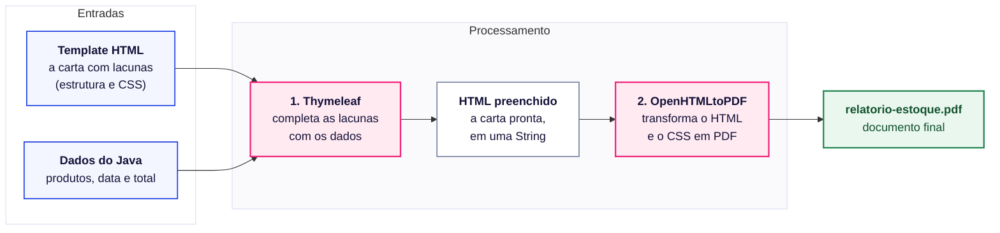

# Gerando PDF em Java com Thymeleaf + OpenHTMLtoPDF

Existem várias formas de gerar PDF em Java. Dá para desenhar o documento direto no código, com
bibliotecas como Apache PDFBox, iText ou OpenPDF, posicionando cada texto e cada linha. Dá também
para usar ferramentas de relatório como o JasperReports, que têm o próprio formato de template.

Aqui vamos por outro caminho: escrever o documento em HTML e CSS e converter essa página em PDF.
Escolhemos esse caminho porque:

- você já conhece HTML e CSS, então não precisa aprender uma API de desenho nova;
- para mudar o visual do documento basta editar o HTML e o CSS, sem mexer no código Java;
- as bibliotecas usadas são de código aberto e podem ser usadas em projetos comerciais.

Neste tutorial você vai gerar um relatório de estoque em PDF a partir de um template HTML. O
relatório tem título, data de geração, uma tabela de produtos e o valor total no final.

## Rode o exemplo primeiro

Antes de olhar o código, veja o resultado:

1. Clone o repositório.
2. Abra o projeto no IntelliJ ou na IDE que você preferir.
3. Execute a classe `Main`.
4. Abra o arquivo `relatorio-estoque.pdf`, que vai aparecer na raiz do projeto.

Com o PDF aberto do lado, fica mais fácil acompanhar o resto do tutorial.

## Como funciona

A ideia não é montar o PDF dentro do Java, mas sim escrever um template HTML com CSS, assim como
uma página web, e depois converter esse template para PDF.

Pense numa carta modelo que começa com "Prezado(a) ______". Para enviar a carta a várias pessoas,
você não reescreve tudo: completa a lacuna com o nome de cada uma e manda imprimir. Aqui acontece o mesmo, em duas etapas, cada
uma com sua biblioteca:



As caixas rosa são as bibliotecas. As azuis são o que entra, a branca é o resultado intermediário e
a verde é o arquivo final.

| Etapa | Biblioteca        | Entrada                      | Saída                  |
|-------|-------------------|------------------------------|------------------------|
| 1     | **Thymeleaf**     | template `.html` + dados     | HTML completo (String) |
| 2     | **OpenHTMLtoPDF** | HTML completo                | arquivo `.pdf`         |

### Etapa 1: Thymeleaf, quem preenche as lacunas

O Thymeleaf é um motor de templates. Você escreve um HTML com algumas marcações especiais
(`th:text`, `th:each`...) e ele troca essas marcações pelos dados reais. O resultado é um HTML
comum, já com os dados dentro.

Ele é muito usado junto com o Spring Boot para gerar páginas web, mas também funciona sozinho, em
Java puro. É assim que vamos usar aqui.

### Etapa 2: OpenHTMLtoPDF, quem transforma o HTML em PDF

O OpenHTMLtoPDF lê um HTML com CSS e "imprime" o resultado em PDF. Por baixo, ele usa o Apache
PDFBox para escrever o arquivo. O código é aberto, sob a licença LGPL, que permite usar a
biblioteca em projetos comerciais sem abrir o código do seu sistema.

## Arquivos do projeto

| Arquivo                                     | Responsabilidade                                              |
|---------------------------------------------|---------------------------------------------------------------|
| `Produto.java`                              | Representa um item do estoque. Calcula o próprio valor total. |
| `resources/templates/relatorio-estoque.html`| Layout do relatório (HTML + CSS + marcações do Thymeleaf).     |
| `GeradorHtml.java`                          | Etapa 1: configura o Thymeleaf e preenche o template.         |
| `ConversorPdf.java`                         | Etapa 2: converte o HTML em PDF com o OpenHTMLtoPDF.           |
| `Main.java`                                 | Cria os produtos de exemplo e chama as duas etapas.           |

Quando você executa a `Main`, ela cria a lista de produtos e entrega para o `GeradorHtml`. Ele
devolve o HTML pronto, que vai para o `ConversorPdf`, e é ele quem grava o PDF no disco.

## Passo a passo

### 1. Adicione as dependências no `pom.xml`

O Maven baixa as bibliotecas listadas no `pom.xml`. Precisamos de duas, uma para cada etapa:

```xml

<dependencies>
  <!-- Monta o HTML a partir de um template + dados -->
  <dependency>
    <groupId>org.thymeleaf</groupId>
    <artifactId>thymeleaf</artifactId>
    <version>3.1.3.RELEASE</version>
  </dependency>
  <!-- Converte o HTML em PDF -->
  <dependency>
    <groupId>io.github.openhtmltopdf</groupId>
    <artifactId>openhtmltopdf-pdfbox</artifactId>
    <version>1.1.37</version>
  </dependency>
</dependencies>
```

> [!NOTE]
> Repare no `groupId` `io.github.openhtmltopdf`. Muitos exemplos na internet usam o antigo,
> `com.openhtmltopdf`; o código Java é o mesmo nos dois.

> [!NOTE]
> Quando você rodar o projeto, podem aparecer no console mensagens como
> `SLF4J(W): No SLF4J providers were found` e algumas linhas `INFO` do OpenHTMLtoPDF. São só avisos
> de log, pode ignorar.

### 2. Crie o template HTML

O template é a "carta com lacunas". Ele fica em
`src/main/resources/templates/relatorio-estoque.html` e é um HTML comum, com duas diferenças:

- a declaração `xmlns:th="http://www.thymeleaf.org"` na tag `<html>`, que libera os atributos
  `th:*`;
- os atributos `th:*` nos lugares onde os dados vão entrar.

O trecho abaixo é uma versão resumida, só com a tabela. O arquivo completo no projeto também mostra
a data de geração e o valor total.

```html
<!DOCTYPE html>
<html xmlns:th="http://www.thymeleaf.org" lang="pt-BR">
<head>
  <meta charset="UTF-8"/>
  <style>
    /* CSS do relatório (veja o arquivo completo no projeto) */
  </style>
</head>
<body>

<h1>Relatório de Estoque</h1>

<table>
  <tr th:each="produto : ${produtos}">
    <td th:text="${produto.id}">1</td>
    <td th:text="${produto.nome}">Produto de exemplo</td>
    <td th:text="${produto.categoria}">Categoria</td>
  </tr>
</table>

</body>
</html>
```

Leia a tabela do HTML de dentro para fora:

| Atributo / expressão             | O que faz                                                                       |
|----------------------------------|---------------------------------------------------------------------------------|
| `${produtos}`                    | Vai ler a variável `produtos`, uma lista que o Java ainda vai enviar para o template. Você cria essa variável no passo 4. |
| `th:each="produto : ${produtos}"`| Repete a tag (aqui, a linha `<tr>`) uma vez para cada item da lista. É o `for` do HTML. |
| `th:text="${produto.nome}"`      | Troca o texto da tag pelo valor. Por baixo, chama `produto.getNome()`.           |

> [!TIP]
> Viu o `Produto de exemplo` e o `Categoria` dentro das tags? Eles só servem enquanto você monta o
> layout. Abra o `.html` direto no navegador e você vê a tabela com esses textos no lugar dos dados
> reais. Quando o Thymeleaf processa o template, eles somem e entram os valores de cada produto.

> [!WARNING]
> Cada item da lista `produtos` vai ser um objeto da classe `Produto`, que está em `Produto.java`.
> Abra esse arquivo e repare nos getters. O Thymeleaf não lê os atributos diretamente: quando você
> escreve `${produto.nome}`, ele chama `getNome()`. Se o getter não existir, o processamento para
> com uma exceção. Então, para cada atributo que o template usar, a classe precisa do getter
> correspondente (`${produto.categoria}` chama `getCategoria()`, e assim por diante).

> [!IMPORTANT]
> O OpenHTMLtoPDF exige um HTML bem formado, no estilo XHTML: toda tag aberta precisa ser fechada.
> O navegador aceita `<br>` e `` sem fechar, mas aqui a conversão falha com um erro
> parecido com este:
>
> ```
> SAXParseException: O tipo de elemento "br" deve ser encerrado pela tag final correspondente "</br>".
> ```
>
> Então, no template, escreva sempre `<br/>`, ``, `<meta charset="UTF-8"/>`.

### 3. Estilize com CSS e configure a página

Todo o visual fica no `<style>` do template, com CSS normal: cores, bordas, tamanhos de fonte,
linhas zebradas na tabela.

A novidade é o `@page`. Uma página web não tem tamanho fixo: ela cresce para baixo e o usuário
rola a tela. Um PDF é diferente, porque o conteúdo é dividido em folhas de papel com tamanho e
margens definidos. O CSS comum não tem como dizer "use folha A4 com margem de 1,5 cm", e o `@page`
existe justamente para isso. Ele é uma regra de CSS feita para impressão, e o OpenHTMLtoPDF a
usa para saber como montar cada página do PDF.

Sem o `@page`, a biblioteca usa um tamanho e margens padrão, que podem não ser os que você quer.
Com ele você controla o tamanho do papel, as margens e até um rodapé com o número da página:

```css
@page {
  size: A4;
  margin: 1.5cm;

  @bottom-right {
    content: "Página " counter(page) " de " counter(pages);
    font-size: 9px;
  }
}
```

`counter(page)` é o número da página atual e `counter(pages)` é o total. Se o relatório crescer e
ocupar três páginas, o rodapé mostra "Página 1 de 3", "Página 2 de 3" e assim por diante, sem
nenhuma linha extra de Java.

> [!WARNING]
> Nem todo CSS funciona aqui. Flexbox e CSS Grid, por exemplo, são ignorados. Veja a seção
> [Limitações](#limitações) antes de caprichar no layout.

### 4. Preencha o template com os dados (`GeradorHtml`)

Aqui acontece a etapa 1: o Java entrega os dados e o Thymeleaf preenche as lacunas. São duas
partes.

#### 4.1. Diga ao Thymeleaf onde estão os templates

O `ClassLoaderTemplateResolver` procura os arquivos dentro de `src/main/resources`:

```java
ClassLoaderTemplateResolver resolver = new ClassLoaderTemplateResolver();
resolver.setPrefix("templates/");
resolver.setSuffix(".html");
resolver.setTemplateMode(TemplateMode.HTML);
resolver.setCharacterEncoding("UTF-8");

TemplateEngine templateEngine = new TemplateEngine();
templateEngine.setTemplateResolver(resolver);
```

O prefixo e o sufixo poupam você de escrever o caminho inteiro. Quando você pedir o template
`"relatorio-estoque"`, o Thymeleaf monta `templates/` + `relatorio-estoque` + `.html` e encontra o
arquivo do passo 2.

#### 4.2. Envie os dados e processe

O template não enxerga as variáveis do seu código Java. Se você tem uma lista chamada `produtos`
no método, o `${produtos}` do HTML não sabe que ela existe. Para os dados chegarem até o template,
precisamos de um intermediário: o `Context`.

Pense no `Context` como uma caixa onde você guarda tudo o que o template vai precisar, cada item
com uma etiqueta. O `setVariable` coloca um item na caixa: o primeiro argumento é a etiqueta (o
nome que o HTML vai usar) e o segundo é o valor. Depois você entrega a caixa ao Thymeleaf junto
com o nome do template, e ele procura na caixa cada `${...}` que encontrar no HTML:

```java
Context contexto = new Context();
contexto.setVariable("produtos", produtos);          // vira ${produtos}
contexto.setVariable("valorTotal", valorTotalEstoque); // vira ${valorTotal}
contexto.setVariable("dataGeracao", LocalDate.now()); // vira ${dataGeracao}

String html = templateEngine.process("relatorio-estoque", contexto);
```

O nome que você passa no `setVariable` precisa ser o mesmo usado no template: `"produtos"` aqui,
`${produtos}` lá.

O `process()` devolve o HTML já preenchido em forma de `String`. Repare que ainda não existe PDF
nenhum; ele só aparece no próximo passo.

### 5. Converta o HTML em PDF (`ConversorPdf`)

Agora a etapa 2. O `PdfRendererBuilder` funciona em duas fases: primeiro você configura tudo o que
precisa, depois chama `run()`, que faz a conversão de fato.

```java
try (OutputStream arquivo = new FileOutputStream("relatorio-estoque.pdf")) {
    PdfRendererBuilder builder = new PdfRendererBuilder();
    builder.useFastMode();
    builder.withHtmlContent(html, null);
    builder.toStream(arquivo);
    builder.run();
}
```

| Método                         | Descrição                                                                                 |
|--------------------------------|-------------------------------------------------------------------------------------------|
| `useFastMode()`                | Usa o renderizador mais novo e mais rápido. A documentação recomenda sempre ativar.        |
| `withHtmlContent(html, baseUri)` | Recebe o HTML. O `baseUri` serve para achar arquivos com caminho relativo (imagens, CSS externo). Como não usamos nenhum, passamos `null`. |
| `toStream(saida)`              | Onde o PDF será escrito. Pode ser um arquivo ou um `ByteArrayOutputStream`.               |
| `run()`                        | Executa a conversão. Antes dele, nada acontece.                                           |

### 6. Junte as duas etapas (`Main`)

Com as duas classes prontas, a `Main` só precisa chamar uma depois da outra:

```java
GeradorHtml geradorHtml = new GeradorHtml();
String html = geradorHtml.gerarHtmlRelatorioEstoque(produtos);

ConversorPdf conversorPdf = new ConversorPdf();
conversorPdf.converterHtmlParaPdf(html, "relatorio-estoque.pdf");
```

Deixar cada etapa na sua classe ajuda no futuro: se você quiser mandar o mesmo relatório por
e-mail em HTML, o `GeradorHtml` já resolve essa parte.

## Experimente

Mexer no código é o jeito mais rápido de fixar o que você viu. Rode a `Main` depois de cada
mudança e abra o PDF de novo:

1. Adicione um produto na lista criada na `Main`. A tabela ganha uma linha e o valor total muda,
   sem você tocar no template.
2. No `@page`, troque `size: A4` por `size: A4 landscape` para gerar o relatório em paisagem.
3. Coloque `display: flex` em algum elemento do CSS e procure o aviso no console.
4. Tire a barra de `<meta charset="UTF-8"/>` no template e veja o `SAXParseException` acontecer.

## Limitações

Antes de usar essa abordagem num projeto seu, vale a pena conhecer as limitações dela.

### O CSS suportado é antigo

O OpenHTMLtoPDF não é um navegador. Ele implementa basicamente o CSS 2.1, com alguns recursos do
CSS 3 (como `border-radius` e as regras de `@page`). Flexbox e CSS Grid não funcionam. Se você
escrever `display: flex`, a biblioteca ignora a linha e só mostra um aviso no console:

```
css-parse WARNING:: Value flex is not a recognized identifier. Skipping declaration.
```

Para montar colunas e alinhamentos, use tabelas (`<table>`), `float` ou `display: inline-block`,
como nos sites antigos. Por isso um HTML perfeito no Chrome pode sair diferente no PDF. Confira
sempre o PDF gerado, não o navegador.

### O HTML precisa ser XHTML válido

Como você viu no passo 2, uma tag sem fechamento quebra a conversão. Se o HTML vier de uma fonte
que você não controla (um editor de texto rico, por exemplo), vai precisar "limpar" esse HTML antes
de converter. A biblioteca jsoup costuma ser usada para isso.

### Não executa JavaScript

Gráficos do Chart.js, conteúdo carregado com `fetch` e qualquer outra coisa que dependa de
JavaScript ficam de fora do PDF.

> [!TIP]
> **E se eu quiser um gráfico?** Você tem dois caminhos.
>
> Para um gráfico de barras simples, dá para desenhar com HTML e CSS mesmo. Cada barra é um
> elemento com cor de fundo, e a largura vem dos dados pelo Thymeleaf:
>
> ```html
> <div th:each="produto : ${produtos}">
>   <span th:text="${produto.nome}">Produto</span>
>   <div style="background: #1B3FE0; height: 12px;"
>        th:style="'background: #1B3FE0; height: 12px; width: ' + ${produto.percentual} + '%'"></div>
> </div>
> ```
>
> Aqui `percentual` seria um getter novo na classe `Produto`, com um valor de 0 a 100 calculado no
> Java.
>
> Para gráficos mais elaborados (pizza, linhas), gere uma imagem no Java com uma biblioteca como a
> JFreeChart, salve como PNG e coloque no HTML com ``. Lembre de informar o
> `baseUri` em `withHtmlContent` para a imagem ser encontrada (veja a próxima seção). Se preferir
> SVG, adicione também a dependência `openhtmltopdf-svg-support`.

### Fontes, imagens e caminhos

Por padrão você só tem as fontes básicas do PDF (Helvetica, Times, Courier). Para usar outra, é
preciso registrá-la no builder com `builder.useFont(arquivoTtf, "NomeDaFonte")`.

Imagens com caminho relativo (``) só funcionam se você informar o `baseUri`
em `withHtmlContent`. Com `null`, a biblioteca não sabe onde procurar o arquivo e a imagem
simplesmente não aparece.

### O que as outras bibliotecas fazem melhor

Lembra das outras formas de gerar PDF citadas no começo? Em alguns casos elas levam vantagem.

Bibliotecas que desenham o PDF direto no código, como Apache PDFBox, iText e OpenPDF:

- são mais rápidas, porque não precisam interpretar um HTML antes de desenhar a página. Para um
  relatório por vez a diferença não aparece, mas para gerar milhares de PDFs em lote ela pesa;
- dão controle exato da posição de cada elemento na página, sem depender de como o CSS vai ser
  interpretado;
- fazem coisas que estão fora do escopo do OpenHTMLtoPDF: formulários preenchíveis, assinatura
  digital, criptografia e edição de um PDF que já existe.

O JasperReports, por sua vez, foi feito para relatórios. Ele tem um editor visual para montar o
layout e já resolve sozinho coisas comuns em relatório, como agrupamentos, subtotais e gráficos.

## Quando vale a pena usar?

Thymeleaf + OpenHTMLtoPDF costuma ser uma boa escolha quando:

- o documento tem um visual elaborado que muda com frequência, já que mudar o layout é só editar o
  HTML e o CSS;
- quem cuida do layout sabe HTML e CSS, mas não programa em Java;
- o projeto é comercial e não pode abrir o código (a licença LGPL permite esse uso).

Já se você precisa de recursos específicos de PDF (assinatura, formulários, editar um arquivo
existente) ou de gerar um volume muito grande de documentos com o máximo de desempenho, procure
outra ferramenta.

## Documentação oficial

Se ficar alguma dúvida, a documentação oficial é o melhor lugar para continuar:

- Thymeleaf (guia "Using Thymeleaf"):
  [https://www.thymeleaf.org/doc/tutorials/3.1/usingthymeleaf.html](https://www.thymeleaf.org/doc/tutorials/3.1/usingthymeleaf.html)
- Thymeleaf (página com toda a documentação):
  [https://www.thymeleaf.org/documentation.html](https://www.thymeleaf.org/documentation.html)
- OpenHTMLtoPDF (repositório mantido, com README e exemplos):
  [https://github.com/openhtmltopdf/openhtmltopdf](https://github.com/openhtmltopdf/openhtmltopdf)
- OpenHTMLtoPDF (guia de integração do projeto original, ainda válido para a API):
  [https://github.com/danfickle/openhtmltopdf/wiki/Integration-Guide](https://github.com/danfickle/openhtmltopdf/wiki/Integration-Guide)
