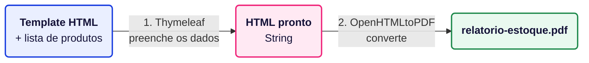

# Exemplo de geração de PDF em Java utilizando Thymeleaf + OpenHTMLtoPDF

## ⚙️ Configuração de ambiente

### Passo a passo da execução:

1. Clonar Repositório
2. Abrir projeto no IntelliJ ou sua IDE de preferência
3. Executar a classe `Main` na IDE
4. Abrir o arquivo `relatorio-estoque.pdf`, que aparece na raiz do projeto

## Qual é a ideia?

Em vez de montar o PDF peça por peça em código Java, vamos escrever o layout do documento em
**HTML e CSS**, como se fosse uma página web, e depois converter essa página em PDF.

O processo tem duas etapas, e cada uma usa uma biblioteca diferente:



| Etapa | Biblioteca        | Entrada                      | Saída                  |
|-------|-------------------|------------------------------|------------------------|
| 1     | **Thymeleaf**     | template `.html` + dados     | HTML completo (String) |
| 2     | **OpenHTMLtoPDF** | HTML completo                | arquivo `.pdf`         |

Neste exemplo, vamos gerar um **relatório de estoque** com título, data de geração, uma tabela de
produtos e o valor total no final.

## O que é o Thymeleaf?

O Thymeleaf é um **motor de templates**: você escreve um HTML com algumas marcações especiais
(`th:text`, `th:each`...) e ele substitui essas marcações pelos dados reais.

Uma comparação que ajuda: o template é uma carta de "Prezado(a) ______". O Thymeleaf é quem
preenche a lacuna com o nome de cada pessoa.

O Thymeleaf é muito usado junto com o Spring Boot para gerar páginas web, mas ele funciona sozinho
também, em Java puro, que é o que faremos aqui.

## O que é o OpenHTMLtoPDF?

O OpenHTMLtoPDF é uma biblioteca que lê um HTML com CSS e "imprime" o resultado em PDF. Por baixo,
ela usa o **Apache PDFBox** para escrever o arquivo. É código aberto sob a licença **LGPL**, que
permite usar em projetos comerciais sem abrir o código do seu sistema.

## Gerando PDF com Thymeleaf + OpenHTMLtoPDF

### 1. Adicione as dependências Maven necessárias ao seu arquivo `pom.xml`:

```xml

<dependencies>
  <!-- Monta o HTML a partir de um template + dados -->
  <dependency>
    <groupId>org.thymeleaf</groupId>
    <artifactId>thymeleaf</artifactId>
    <version>3.1.3.RELEASE</version>
  </dependency>
  <!-- Converte o HTML em PDF -->
  <dependency>
    <groupId>io.github.openhtmltopdf</groupId>
    <artifactId>openhtmltopdf-pdfbox</artifactId>
    <version>1.1.37</version>
  </dependency>
</dependencies>
```

> [!NOTE]
> Repare no `groupId` `io.github.openhtmltopdf`. O projeto original (`com.openhtmltopdf`) parou na
> versão 1.0.10 e foi arquivado; o desenvolvimento continua nesse novo endereço, mantido pela
> comunidade. Muitos exemplos na internet ainda usam o `groupId` antigo, e o código Java é o mesmo
> nos dois.

> [!NOTE]
> Ao rodar, podem aparecer no console mensagens como `SLF4J(W): No SLF4J providers were found` e
> algumas linhas `INFO` do OpenHTMLtoPDF. São avisos de log e não indicam erro.

---

### 2. Crie o template HTML

O template fica em `src/main/resources/templates/relatorio-estoque.html`. Ele é um HTML comum, com
dois detalhes:

- a declaração `xmlns:th="http://www.thymeleaf.org"` na tag `<html>`, que libera os atributos
  `th:*`;
- os atributos `th:*` nos lugares onde entram os dados.

```html
<!DOCTYPE html>
<html xmlns:th="http://www.thymeleaf.org" lang="pt-BR">
<head>
  <meta charset="UTF-8"/>
  <style>
    /* CSS do relatório (veja o arquivo completo no projeto) */
  </style>
</head>
<body>

<h1>Relatório de Estoque</h1>

<table>
  <tr th:each="produto : ${produtos}">
    <td th:text="${produto.id}">1</td>
    <td th:text="${produto.nome}">Produto de exemplo</td>
    <td th:text="${produto.categoria}">Categoria</td>
  </tr>
</table>

</body>
</html>
```

Os atributos que usamos no exemplo:

| Atributo / expressão             | O que faz                                                                       |
|----------------------------------|---------------------------------------------------------------------------------|
| `${produtos}`                    | Lê a variável `produtos`, que o Java vai enviar para o template.                 |
| `th:each="produto : ${produtos}"`| Repete a tag (aqui, a linha `<tr>`) uma vez para cada item da lista. É o `for` do HTML. |
| `th:text="${produto.nome}"`      | Troca o texto da tag pelo valor. Por baixo, chama `produto.getNome()`.           |
| `#numbers.formatDecimal(...)`    | Formata números. Usamos para escrever `3.748,50` em vez de `3748.5`.             |
| `#temporals.format(data, 'dd/MM/yyyy')` | Formata datas do `java.time` (como `LocalDate`).                          |

> [!WARNING]
> O texto que fica **dentro** das tags (`Produto de exemplo`, `R$ 0,00`) é só um texto
> provisório. Ele aparece se você abrir o `.html` direto no navegador, o que ajuda a visualizar o
> layout, mas o Thymeleaf substitui tudo na hora de processar.

> [!WARNING]
> O `${produto.nome}` só funciona porque a classe `Produto` tem o método `getNome()`. Sem getter,
> o Thymeleaf não consegue ler o atributo e lança uma exceção. O mesmo vale para `valorTotal`, que
> funciona por causa do método `getValorTotal()`.

---

### 3. Estilize com CSS (e configure a página)

Todo o visual fica no `<style>` do template, com CSS normal: cores, bordas, tamanhos de fonte,
linhas zebradas na tabela.

A parte diferente é o `@page`, uma regra de CSS feita para impressão. Com ela você define o tamanho
do papel, as margens e até um rodapé com o número da página:

```css
@page {
  size: A4;
  margin: 1.5cm;

  @bottom-right {
    content: "Página " counter(page) " de " counter(pages);
    font-size: 9px;
  }
}
```

> [!NOTE]
> O `counter(page)` é o número da página atual e o `counter(pages)` é o total de páginas. Se o
> relatório crescer e ocupar três páginas, o rodapé passa a mostrar "Página 1 de 3", "Página 2 de 3"
> e assim por diante, sem nenhuma linha extra de Java.

---

### 4. Configure o Thymeleaf e preencha o template (`GeradorHtml`)

Primeiro configuramos **onde** o Thymeleaf vai procurar os templates. O
`ClassLoaderTemplateResolver` procura dentro de `src/main/resources`:

```java
ClassLoaderTemplateResolver resolver = new ClassLoaderTemplateResolver();
resolver.setPrefix("templates/");
resolver.setSuffix(".html");
resolver.setTemplateMode(TemplateMode.HTML);
resolver.setCharacterEncoding("UTF-8");

TemplateEngine templateEngine = new TemplateEngine();
templateEngine.setTemplateResolver(resolver);
```

Com prefixo e sufixo configurados, quando pedirmos o template `"relatorio-estoque"` o Thymeleaf
monta o caminho `templates/relatorio-estoque.html`.

Depois enviamos os dados para o template usando um `Context`. Cada `setVariable` cria uma variável
que o HTML enxerga com `${...}`:

```java
Context contexto = new Context();
contexto.setVariable("produtos", produtos);          // vira ${produtos}
contexto.setVariable("valorTotal", valorTotalEstoque); // vira ${valorTotal}
contexto.setVariable("dataGeracao", LocalDate.now()); // vira ${dataGeracao}

String html = templateEngine.process("relatorio-estoque", contexto);
```

O método `process()` devolve uma `String` com o HTML já preenchido. Ainda não existe PDF nenhum
nesse ponto; isso é trabalho da próxima etapa.

---

### 5. Converta o HTML em PDF (`ConversorPdf`)

```java
try (OutputStream arquivo = new FileOutputStream("relatorio-estoque.pdf")) {
    PdfRendererBuilder builder = new PdfRendererBuilder();
    builder.useFastMode();
    builder.withHtmlContent(html, null);
    builder.toStream(arquivo);
    builder.run();
}
```

| Método                         | Descrição                                                                                 |
|--------------------------------|-------------------------------------------------------------------------------------------|
| `useFastMode()`                | Usa o renderizador mais novo e mais rápido. A documentação recomenda sempre ativar.        |
| `withHtmlContent(html, baseUri)` | Recebe o HTML. O `baseUri` serve para achar arquivos com caminho relativo (imagens, CSS externo). Como não usamos nenhum, passamos `null`. |
| `toStream(saida)`              | Onde o PDF será escrito. Pode ser um arquivo ou um `ByteArrayOutputStream`.               |
| `run()`                        | Executa a conversão. Antes dele, nada acontece.                                           |

---

### 6. Junte as duas etapas (`Main`)

```java
GeradorHtml geradorHtml = new GeradorHtml();
String html = geradorHtml.gerarHtmlRelatorioEstoque(produtos);

ConversorPdf conversorPdf = new ConversorPdf();
conversorPdf.converterHtmlParaPdf(html, "relatorio-estoque.pdf");
```

Separar em duas classes tem uma vantagem: se amanhã você quiser enviar o mesmo relatório por
e-mail (em HTML) além de gerar o PDF, o `GeradorHtml` já está pronto para isso.

> [!IMPORTANT]
> O OpenHTMLtoPDF exige um HTML **bem formado**, no estilo XHTML: toda tag aberta precisa ser
> fechada. Navegadores aceitam `<br>` e `` sem fechar, mas aqui a conversão falha com
> um erro parecido com este:
>
> ```
> SAXParseException: O tipo de elemento "br" deve ser encerrado pela tag final correspondente "</br>".
> ```
>
> Por isso, no template, escreva sempre `<br/>`, ``, `<meta charset="UTF-8"/>`.

---

## Estrutura do projeto

| Arquivo                                     | Responsabilidade                                              |
|---------------------------------------------|---------------------------------------------------------------|
| `Produto.java`                              | Representa um item do estoque. Calcula o próprio valor total. |
| `GeradorHtml.java`                          | Configura o Thymeleaf e preenche o template com os dados.     |
| `ConversorPdf.java`                         | Converte o HTML em PDF com o OpenHTMLtoPDF.                    |
| `Main.java`                                 | Cria os produtos de exemplo e chama as duas etapas.           |
| `resources/templates/relatorio-estoque.html`| Layout do relatório (HTML + CSS + marcações do Thymeleaf).     |

## ⚠️ Limitações do Thymeleaf + OpenHTMLtoPDF

### 1. O CSS suportado é antigo

O OpenHTMLtoPDF não é um navegador. Ele implementa basicamente o **CSS 2.1**, com alguns recursos
do CSS 3 (como `border-radius` e as regras de `@page`). Não há suporte a **Flexbox** nem a **CSS
Grid**. Se você escrever `display: flex`, a biblioteca ignora a linha e mostra só um aviso no
console:

```
css-parse WARNING:: Value flex is not a recognized identifier. Skipping declaration.
```

Para montar colunas e alinhamentos, use tabelas (`<table>`), `float` ou `display: inline-block`,
como se fazia em sites antigos. Por isso, um HTML que fica perfeito no Chrome pode sair diferente
no PDF. Teste sempre olhando o PDF gerado, e não o navegador.

### 2. Não executa JavaScript

Gráficos feitos com Chart.js, conteúdo carregado com `fetch` ou qualquer coisa que dependa de
JavaScript **não aparece** no PDF. Se precisar de um gráfico, gere uma imagem (PNG ou SVG) no Java
e coloque no HTML com ``. Para SVG, é preciso adicionar a dependência
`openhtmltopdf-svg-support`.

### 3. HTML precisa ser XHTML válido

Como vimos no aviso acima, tags sem fechamento quebram a conversão. Se o HTML vier de uma fonte que
você não controla (um editor de texto rico, por exemplo), você vai precisar de uma etapa extra para
"limpar" o HTML antes de converter. A biblioteca **jsoup** costuma ser usada para isso.

### 4. Fontes, imagens e caminhos

Por padrão estão disponíveis só as fontes básicas do PDF (Helvetica, Times, Courier). Para usar uma
fonte própria você precisa registrá-la no builder com `builder.useFont(arquivoTtf, "NomeDaFonte")`.

Imagens com caminho relativo (``) só funcionam se você informar o `baseUri`
em `withHtmlContent`. Com `null`, a biblioteca não sabe onde procurar o arquivo e a imagem
simplesmente não aparece.

### 5. Duas bibliotecas, mais dependências e mais lentidão

Você passa a depender de duas bibliotecas (e, por tabela, do PDFBox). O processo também é mais
lento que montar o PDF direto em código, porque o HTML precisa ser interpretado e "desenhado" antes
de virar PDF. Para um relatório por vez isso é imperceptível; para gerar milhares de PDFs em lote,
vale medir.

### 6. Pouco controle fino sobre o PDF

Recursos específicos de PDF, como formulários preenchíveis, assinatura digital, criptografia ou
editar um PDF que já existe, estão fora do escopo do OpenHTMLtoPDF. Para isso, o mais indicado é
uma biblioteca que trabalha direto com a estrutura do PDF, como o Apache PDFBox.

## Quando essa abordagem vale a pena?

Thymeleaf + OpenHTMLtoPDF costuma ser uma boa escolha quando:

- o documento tem visual elaborado e muda com frequência, já que alterar o layout é só editar o
  HTML e o CSS;
- quem cuida do layout sabe HTML e CSS, mas não programa em Java;
- o projeto é comercial e não pode abrir o código, porque a licença LGPL permite esse uso.

Ela deixa de ser uma boa escolha quando você precisa de recursos específicos de PDF (assinatura,
formulários, editar um arquivo existente) ou de gerar um volume muito grande de documentos com o
máximo de desempenho.

## 📚 Documentação oficial

Caso tenha alguma dúvida, recomendamos ler a documentação oficial:

- Thymeleaf (guia "Using Thymeleaf"):
  [https://www.thymeleaf.org/doc/tutorials/3.1/usingthymeleaf.html](https://www.thymeleaf.org/doc/tutorials/3.1/usingthymeleaf.html)
- Thymeleaf (página com toda a documentação):
  [https://www.thymeleaf.org/documentation.html](https://www.thymeleaf.org/documentation.html)
- OpenHTMLtoPDF (repositório mantido, com README e exemplos):
  [https://github.com/openhtmltopdf/openhtmltopdf](https://github.com/openhtmltopdf/openhtmltopdf)
- OpenHTMLtoPDF (guia de integração do projeto original, ainda válido para a API):
  [https://github.com/danfickle/openhtmltopdf/wiki/Integration-Guide](https://github.com/danfickle/openhtmltopdf/wiki/Integration-Guide)
